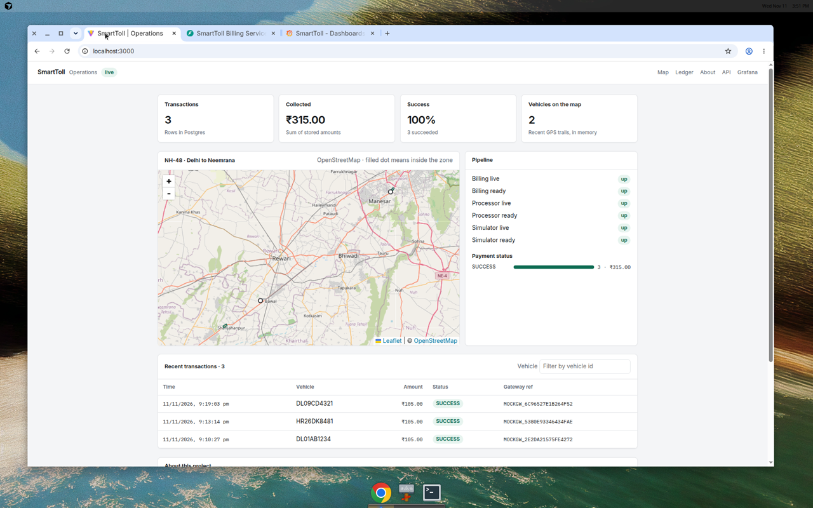
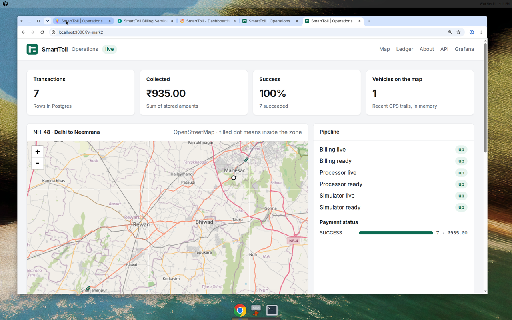
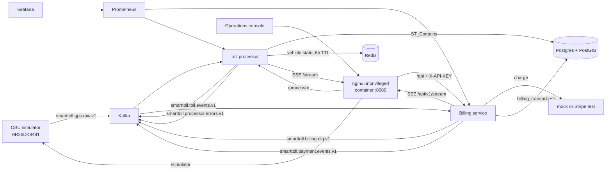
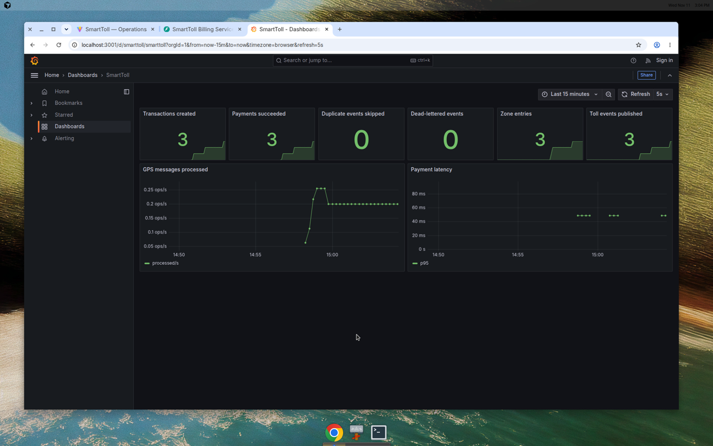

# SmartToll

[](https://github.com/hooiv/smarttoll-prod/actions/workflows/ci.yml)

GPS fixes on NH-48 become INR toll charges, from a simulated car to a Postgres row you can see on a map.

SmartToll is a local toll pipeline for the Delhi to Neemrana stretch of NH-48. A simulator drives the highway and publishes positions to Kafka. A processor detects plaza crossings. A billing service records one idempotent charge per crossing. The operations console, Prometheus, and Grafana all come up with the same Compose file. No paid account is required. The default payment gateway never leaves the process.



## Quick start

```bash
cp .env.example .env
docker compose up -d
```

The first start builds images and waits until Kafka is healthy. `docker compose ps` should then show every service healthy, including the simulator.

| Surface | URL |
|---|---|
| Operations console | http://localhost:3000 |
| Billing API, Swagger | http://localhost:8001/docs |
| Billing API, ReDoc | http://localhost:8001/redoc |
| Grafana (anonymous viewer) | http://localhost:3001/d/smarttoll/smarttoll |
| Prometheus | http://localhost:9090 |
| Processor liveness | http://localhost:8080/health/live |
| Processor readiness | http://localhost:8080/health/ready |
| Processor metrics | http://localhost:8081/ |
| Processor zones (GeoJSON) | http://localhost:8080/zones |
| Simulator readiness | http://localhost:8082/health/ready |
| Postgres | localhost:5432 |
| Redis | localhost:6379 |
| Kafka (host clients) | localhost:9092 |

Inside the Compose network, Kafka is `kafka:29092`. The console talks only to port 3000. nginx proxies `/api`, `/processor`, and `/simulator`, and adds `X-API-KEY` on the server. Direct calls to port 8001 still send that header. The local default is `supersecretapikey123`.

Grafana's local admin password is `admin` unless `GRAFANA_ADMIN_PASSWORD` is set. Do not expose that port as-is.



## Architecture



One fix is handled like this:

1. The simulator publishes a point on `smarttoll.gps.raw.v1`, keyed by vehicle id, with a `traceId`. The path is a driving trace, not a straight line.
2. The processor rejects timestamps older than 10 minutes or more than 60 seconds ahead.
3. PostGIS `ST_Contains` tests the point against the seeded plaza polygons.
4. Redis keeps the in-zone state for 6 hours. Distance is the sum of Haversine segments, and is stored even when the fee is flat.
5. On exit, the processor publishes one toll event. `eventId` is the idempotency key downstream.
6. Billing inserts a `PENDING` row, calls the gateway, then stores `SUCCESS` or `FAILED`. A second delivery of the same `toll_event_id` does not charge again.
7. A malformed event, or a transient failure past `BILLING_MAX_PROCESS_ATTEMPTS` (default 5), is copied to `smarttoll.billing.dlq.v1`. The offset is committed only after that copy succeeds. Processor failures go to `smarttoll.processor.errors.v1` the same way.
8. Billing pushes `event: transaction` on `GET /api/v1/stream`. The processor pushes `event: map` (zones and recent trails) on `GET /stream` every 2 seconds. The console updates without a manual refresh.

## Corridor

The seeded drive is NH-48 from Mahipalpur in Delhi to just past Shahjahanpur, near Neemrana in Rajasthan. The simulator follows those points for 97.5 km. That length is the driving trace, not the highway chainage. Only booths that still collect a car toll are zones. Sirhaul stopped in 2014. The IGI plaza at Mahipalpur stopped charging cars on 9 November 2025. Kukdola, the planned move of Kherki Daula, is not open.

| Zone | Place | Car, single journey | Source |
|---|---|---|---|
| `NH48-KHERKI` | Kherki Daula, 28.3956 N, 76.9818 E | ₹105 | Effective 19 July 2026, next revision 31 March 2027. [Goodreturns tariff](https://www.goodreturns.in/kherki-daula-toll-plaza-tp136.html). [NHAI TIS plaza 272](https://tis.nhai.gov.in/TollInformation?TollPlazaID=272) still shows the 1 April 2025 figure of ₹85. Hindustan Times, 31 August 2026, reported the Kukdola shift had started and the new booth was not open. |
| `NH48-SHAHJAHANPUR` | Shahjahanpur, NH-48 km 115, 27.9999 N, 76.4306 E | ₹205 | Effective 20 July 2026, next revision 31 March 2027. [Goodreturns tariff](https://www.goodreturns.in/shahjahanpur-toll-plaza-tp579.html). [NHAI TIS plaza 213](https://tis.nhai.gov.in/TollInformation?TollPlazaID=213) still shows the 1 April 2025 figure of ₹200. |

A crossing bills that flat fee. The polygon is the capture area around the booth, not a per-kilometre cordon. The simulator vehicle is `HR26DK8481`. The console shows amounts in INR and times in Asia/Kolkata.

## Configuration

Copy `.env.example` to `.env`. Those values are local defaults, not production secrets. Compose rewrites hostnames (`kafka`, `postgres`, `redis`) for containers.

| Variable | Default | Role |
|---|---|---|
| `POSTGRES_DB` / `USER` / `PASSWORD` | `smarttoll_dev` / `smarttoll_user` / `changeme_in_prod_123!` | Database |
| `KAFKA_BROKER` | `kafka:29092` inside Compose | Broker for services |
| `GPS_TOPIC` | `smarttoll.gps.raw.v1` | Raw fixes |
| `TOLL_EVENT_TOPIC` | `smarttoll.toll.events.v1` | Plaza crossings |
| `PAYMENT_EVENT_TOPIC` | `smarttoll.payment.events.v1` | Charge results |
| `BILLING_DLQ_TOPIC` | `smarttoll.billing.dlq.v1` | Billing dead letter |
| `SERVICE_API_KEY` | `supersecretapikey123` | `X-API-KEY` on transaction routes and the billing stream |
| `PAYMENT_GATEWAY` | `mock` | `mock` or `stripe` |
| `STRIPE_API_KEY` | unset | Required for `stripe`. Must start with `sk_test_` or `rk_test_` |
| `MOCK_PAYMENT_FAIL_RATE` | `0.0` | Share of mock charges that decline |
| `MOCK_PAYMENT_TIMEOUT_RATE` | `0.0` | Share of mock charges that time out |
| `BILLING_MAX_PROCESS_ATTEMPTS` | `5` | Then the message is dead-lettered |
| `TOLL_CURRENCY` | `INR` | Currency on new toll events |
| `SIM_VEHICLE_ID` | `HR26DK8481` | Simulator registration mark |
| `SIM_SEND_INTERVAL_SECONDS` | `5` | Gap between fixes |
| `SIM_NUM_STEPS` | `160` | Samples along the trace before it loops |
| `SMARTTOLL_API_KEY` | unset | Required by `scripts/load_trips.py`. Set it to the same value as `SERVICE_API_KEY`. The script exits if it is missing. |
| `GRAFANA_ADMIN_PASSWORD` | `admin` | Local Grafana admin |
| `LOG_LEVEL` | `INFO` | Service logs |

`PAYMENT_GATEWAY=stripe` creates a test-mode PaymentIntent with `pm_card_visa` and sends `toll_event_id` as the Idempotency-Key. Live keys are rejected at startup. Stripe's INR minimum is ₹50. A smaller toll is stored in metadata and the charge is raised to that minimum.

## API

Transaction routes and `GET /api/v1/stream` require `X-API-KEY`. Comparison is constant time. Every HTTP response carries `X-Request-ID`, and billing logs include it.

| Method | Path | Auth | Purpose |
|---|---|---|---|
| GET | `/api/v1/health/live` | no | Process is up |
| GET | `/api/v1/health/ready` | no | Database and Kafka consumer |
| GET | `/api/v1/version` | no | Service version |
| GET | `/api/v1/stream` | yes | SSE. `hello`, then `transaction` when a charge is recorded, plus a keepalive |
| GET | `/api/v1/transactions` | yes | Page of rows. Filters: `vehicle_id`, `status`. `page`, `page_size` (max 100) |
| GET | `/api/v1/transactions/summary` | yes | Counts and amounts by status |
| GET | `/api/v1/transactions/status/{toll_event_id}` | yes | One row by event id |
| GET | `/api/v1/transactions/{id}` | yes | One row by internal id |
| GET | `/metrics` | no | Prometheus |

The processor, on port 8080, also serves `GET /tracks`, `GET /zones`, and `GET /stream` (SSE `map` events). Those are not behind the API key. The console reaches them through nginx.

## Reliability

Services bind their HTTP ports before Kafka is ready and retry with exponential backoff, capped at 15 seconds. Liveness is "the process is up". Readiness stays 503 until the consumer has polled and the dependency checks pass. Compose restarts with `unless-stopped`.

Offsets are committed by hand, one record at a time. The committed value is that record's offset plus one, which is the next record Kafka should deliver. Billing commits only after the charge is stored, or after the record is copied to `smarttoll.billing.dlq.v1`. The processor commits only after the fix is applied, or after it is copied to `smarttoll.processor.errors.v1`. A commit with no offsets is not used, because that would mark every record from the last poll as done. If the dead-letter publish fails, the offset stays put and the consumer seeks back to that record, so a later record in the same partition cannot move the cursor past it. `auto_offset_reset=earliest` replays anything not yet committed. Billing's unique `toll_event_id` makes that replay safe. A poison message, or a failure after five attempts, goes to the billing dead-letter topic and then the offset moves on. Retry counts live in memory. A crash redelivers uncommitted offsets, and the database unique key stops a second charge.

## Observability

Billing exposes `/metrics` on port 8001. The processor exposes Prometheus on port 8081. Grafana is provisioned with the SmartToll dashboard, so `docker compose up -d` is enough. Anonymous viewers can open it. Logs are JSON. Billing attaches `request_id`. Toll events carry `traceId`.



## Tests and CI

```bash
make test                 # unit tests, no Docker
make lint
make test-integration     # Compose on ports 9093, 6380, 5433, then pytest
SMARTTOLL_API_KEY=supersecretapikey123 python scripts/load_trips.py --vehicles 20
```

`scripts/load_trips.py` reads `SMARTTOLL_API_KEY` from the environment and sends it as `X-API-KEY`. Use the same value as `SERVICE_API_KEY`. The script exits with an error if the variable is missing. The main stack must already be up.

GitHub Actions runs three jobs on every push and pull request: lint plus unit tests, the integration flow (Kafka, PostGIS, Redis, billing API, SSE hello, and `/zones`), and `docker compose build`.

## Security

The API key is injected by nginx. It is not in the JavaScript bundle. Authenticated routes use constant-time comparison. Application images run as a non-root user. The console image is `nginxinc/nginx-unprivileged` and runs as uid 101. Inside the container it listens on 8080, and Compose publishes that as host port 3000. The Kafka client is pinned to `kafka-python-ng==2.2.3`. Stripe test mode refuses live secret keys. The local Grafana password and the sample API key are demo defaults. Change them before any shared network.

Anyone who can open port 3000 can read the ledger. That is acceptable for a local demo and the wrong shape for a public deployment.

## Design decisions

**Kafka is the contract.** The processor and billing service do not call each other. A restart replays the log.

**Plaza fees are flat.** Distance is still recorded. The rupee amount is the published single-journey car rate, because that is how these booths charge.

**The console is a backend for the browser.** It does not hold the API key. Zones, trails, health, and the ledger all come from the services. There is no plaza polygon in the frontend source.

**Migrations own the billing table.** Alembic runs before Uvicorn (`0001` table, `0002` `last_updated` trigger). `create_all` on startup only covers a database that has not been migrated.

**One broker is enough to show the design.** Confluent 7.3 with ZooKeeper is the single-node broker this Compose file is written for.

## Out of scope

- KRaft, a multi-broker cluster, and Kubernetes manifests. The health and metrics endpoints are what an orchestrator would probe.
- A transactional outbox. A crash after the toll is computed and before Kafka accepts it can drop that exit. Idempotency covers replay, not that gap.
- A live tariff feed. Rates are the July 2026 published car fees cited above, not a daily scrape of NHAI.
- Kukdola. It is not an operating plaza yet.
- FASTag, ANPR, and barrier hardware.
- A hours-long soak in CI. `scripts/load_trips.py` is the optional load check.
- A wholesale code reformat. `.flake8` ignores the existing whitespace style so CI can still fail on new classes of defect.
