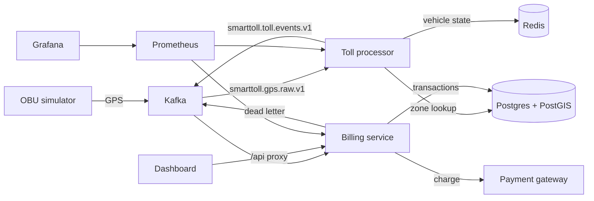

# SmartToll

SmartToll turns a stream of vehicle GPS fixes into toll charges. A simulator (or any producer) publishes positions to Kafka. The toll processor decides when a vehicle enters and leaves a zone, and the billing service records an idempotent charge. Everything runs locally with one command and no paid accounts.

```bash
cp .env.example .env
docker compose up -d
```

`docker compose ps` should show every service healthy, including the simulator. The first startup builds images and waits for Kafka, so give it a couple of minutes.

| Surface | URL |
|---|---|
| Operations console | http://localhost:3000 |
| Billing API (Swagger) | http://localhost:8001/docs |
| Grafana | http://localhost:3001 |
| Prometheus | http://localhost:9090 |
| Toll processor liveness | http://localhost:8080/health/live |
| Toll processor metrics | http://localhost:8081/ |
| Simulator readiness | http://localhost:8082/health/ready |

The operations console at port 3000 is a real view of the stack: recent transactions, payment totals, pipeline health, and a map of Zone1 with the processor's recent GPS trails. nginx proxies `/api`, `/processor`, and `/simulator`, and attaches the API key on the server. The browser bundle does not contain it. Direct calls to the billing service still send `X-API-KEY` (the value in `.env`, default `supersecretapikey123`).

Grafana opens anonymously as a viewer. The local admin password is `admin` unless `GRAFANA_ADMIN_PASSWORD` is set. Do not expose that port as-is.

## Architecture



One GPS fix is handled like this:

1. The simulator publishes a point on `smarttoll.gps.raw.v1`, keyed by vehicle id, with a `traceId`.
2. The processor drops points older than 10 minutes or more than 60 seconds in the future.
3. PostGIS `ST_Contains` answers whether the point is inside a toll zone. Zones are seeded on startup (Zone1 covers the simulator's NYC route, $0.15/km).
4. Redis holds the in-zone state for 6 hours. Distance is the sum of Haversine segments.
5. On exit, the processor publishes one toll event. The event id is the idempotency key for everything downstream.
6. Billing inserts a `PENDING` row, calls the gateway, then stores `SUCCESS` or `FAILED`. A second delivery of the same event id does not charge again.
7. A malformed event, or a transient failure that exhausts `BILLING_MAX_PROCESS_ATTEMPTS` (default 5), is copied to `smarttoll.billing.dlq.v1` and the offset is committed so the partition keeps moving. The processor already publishes its own failures to `smarttoll.processor.errors.v1`.

## Design decisions

**Kafka is the contract.** Services do not call each other. A restart with `auto_offset_reset=earliest` and manual commits replays anything not yet committed. Billing's unique `toll_event_id` makes that replay safe.

**Liveness is not readiness.** HTTP servers bind before Kafka is up and keep retrying with exponential backoff, capped at 15 seconds. Compose healthchecks hit `/health/live`. `/health/ready` stays 503 until the consumer has polled and the database answers. `restart: unless-stopped` covers a process that does exit.

**The payment gateway is an interface.** `PAYMENT_GATEWAY=mock` (the default) never leaves the process. Failures happen only when `MOCK_PAYMENT_FAIL_RATE` or `MOCK_PAYMENT_TIMEOUT_RATE` is above 0, so a demo is deterministic. `PAYMENT_GATEWAY=stripe` builds a Stripe test-mode PaymentIntent (`pm_card_visa`) and sends the toll event id as the Idempotency-Key. Live secret keys are rejected at startup. Stripe's minimum charge is $0.50; smaller tolls are recorded in metadata and charged at the minimum.

**Migrations own the billing schema.** Alembic runs before Uvicorn (`0001` table, `0002` `last_updated` trigger). `create_all` on startup is a safety net for a database that has not been migrated, not a second source of truth.

**The dashboard is a backend-for-frontend, not a second client of the secret.** nginx injects `X-API-KEY`. The browser only talks to port 3000. Anyone who can open the dashboard can see transactions. That is acceptable for a local demo and is the wrong shape for a public internet deployment.

**Metrics are scraped, not logged.** Billing exposes `/metrics`. The processor exposes Prometheus on port 8081. Grafana is provisioned with a SmartToll dashboard so `docker compose up` is enough.

## Configuration

All of it is in `.env`, copied from `.env.example`. The values there are local defaults, not production secrets. Compose overrides hostnames (`kafka`, `postgres`, `redis`) inside the network.

| Variable | Default | What it does |
|---|---|---|
| `PAYMENT_GATEWAY` | `mock` | `mock` or `stripe` |
| `STRIPE_API_KEY` | unset | Required for `stripe`. Must start with `sk_test_` or `rk_test_` |
| `MOCK_PAYMENT_FAIL_RATE` | `0.0` | Fraction of mock charges that decline |
| `MOCK_PAYMENT_TIMEOUT_RATE` | `0.0` | Fraction of mock charges that time out |
| `SERVICE_API_KEY` | `supersecretapikey123` | Required on `/api/v1/transactions*` |
| `GRAFANA_ADMIN_PASSWORD` | `admin` | Local Grafana admin |

Containers run as non-root. The Python Kafka client is pinned to `kafka-python-ng==2.2.3` everywhere. Do not also install `kafka-python`: both distributions write the `kafka` package, and 3.x removes `NoBrokersAvailable`.

## Tests

```bash
make test                 # unit tests, no Docker
make lint
make test-integration     # Compose stack on ports 9093 / 6380 / 5433, then pytest
python scripts/load_trips.py --vehicles 20   # optional, stack must already be up
```

GitHub Actions runs lint, both unit suites, the integration test, and `docker compose build` on every push and pull request.

## API

Transaction routes require `X-API-KEY`. Every response carries `X-Request-ID`, and the billing logs include that id.

| Method | Path | Auth | Purpose |
|---|---|---|---|
| GET | `/api/v1/health/live` | no | Process is up |
| GET | `/api/v1/health/ready` | no | Database and Kafka consumer |
| GET | `/api/v1/version` | no | Build version |
| GET | `/api/v1/transactions` | yes | Paginated list. Filters: `vehicle_id`, `status` |
| GET | `/api/v1/transactions/summary` | yes | Counts and amounts by status |
| GET | `/tracks` | no | Recent GPS trails (processor, port 8080) |
| GET | `/zones` | no | Toll zones as GeoJSON (processor, port 8080) |
| GET | `/api/v1/transactions/{id}` | yes | One row by internal id |
| GET | `/api/v1/transactions/status/{toll_event_id}` | yes | One row by event id |
| GET | `/metrics` | no | Prometheus |

## Trade-offs left in on purpose

- **One Kafka broker and ZooKeeper.** Confluent 7.3 is what the cgroup v2 workaround in Compose was written for. KRaft would be the production broker topology; it does not change the application contract.
- **No Kubernetes manifests.** The probes and metrics endpoints are the contract an orchestrator needs. Compose is the thing a reviewer can run.
- **Haversine, not a road network.** Distance is the GPS path, not a map-matched route. PostGIS is used for the geofence, where a spatial index matters.
- **Retry counts for billing live in memory.** A restart redelivers uncommitted offsets, and the database unique key stops a double charge. The counter itself does not survive a crash, which is the point of the database check.
- **The in-zone trip is not an outbox.** If the process dies after computing a toll and before Kafka accepts it, that exit can be lost. A transactional outbox is the next step if the charge must be exactly-once rather than at-least-once-with-idempotency.
- **Formatter debt.** `.flake8` ignores the pre-existing whitespace style so CI can fail on new classes of defect. Reformatting the tree would bury behavior changes.
- **No hours-long soak in CI.** `scripts/load_trips.py` is the load check. CI covers one full trip through Kafka, PostGIS, Redis, and Postgres.

## Development

Python 3.11 or newer. Install each service from its own `requirements.txt` plus `requirements-dev.txt`. The root `requirements-dev.txt` is the integration-test client and uses the same Kafka library.

```bash
cd billing_service && python -m pytest tests/ -q
cd toll_processor && python -m pytest tests/ -q
```
